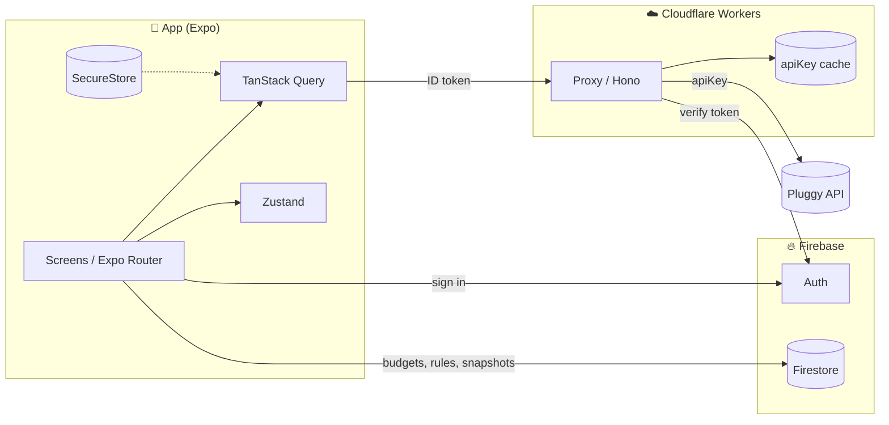
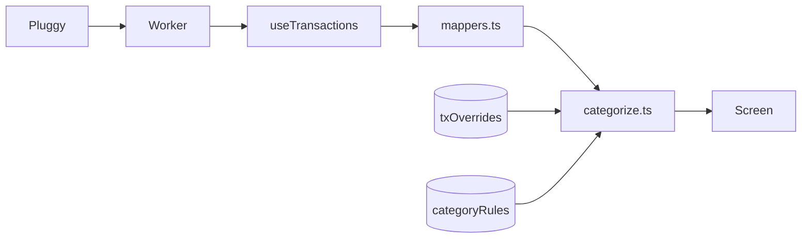

<div align="center">

# 💸 FinTrack

**All your accounts, spending and investments in a single app.**

A mobile app to track balances, income, expenses and net worth, powered by real banking data through Open Finance.


</div>

---

## 📖 Table of Contents

- [Overview](#-overview)
- [Features](#-features)
- [Architecture](#-architecture)
- [Tech Stack](#-tech-stack)
- [Project Structure](#-project-structure)
- [Data Model](#-data-model)
- [Design Decisions](#-design-decisions)
- [Security](#-security)
- [Built to Scale](#-built-to-scale)
- [Getting Started](#-getting-started)
- [Roadmap](#-roadmap)

---

## 🎯 Overview

FinTrack aggregates data from multiple financial institutions using the [Pluggy API](https://pluggy.ai) and delivers a single view of:

- **Up-to-date balances** across all accounts
- **Categorized income and expenses**
- **Investments** across different banks, with allocation and returns
- **Net worth** over time

The project started as a personal tool with zero infrastructure cost, but it was designed from day one to become multi-user without a rewrite.

---

## ✨ Features

### Core

| Module | What it delivers |
| --- | --- |
| **Overview** | Total balance, income vs. expenses for the month, net worth (cash + investments) |
| **Transactions** | Unified list across all accounts, filterable by account, category, period and type |
| **Investments** | Positions by bank and asset type, returns and consolidated total |
| **Budgets** | Per-category limits, progress bars and alerts when a threshold is reached |
| **Accounts** | Sync status for each connection and a manual refresh button |

### Planned

- 🔁 Recurring expense and subscription detection
- 💳 Credit card tracking: current spend, closing date, due date and projection
- 📊 Month-over-month comparison by category
- 🏷️ Manual recategorization with rules, tags and notes
- 🔄 Transfers between own accounts flagged as neutral
- 🥧 Consolidated investment allocation (type, bank, issuer)
- 📈 Net worth evolution with daily snapshots
- 📅 Fixed income maturities (30/60/90 days)
- 🎯 Financial goals linked to accounts or investments
- 🔮 End-of-month balance projection
- 🔔 Notifications for large transactions, low balance and connection errors
- 🙈 Privacy mode, biometric lock and CSV export

---

## 🏗️ Architecture

The app **never talks to Pluggy directly**. The `clientSecret` would end up inside the app bundle, so every request goes through a thin proxy running on Cloudflare Workers.



### Separation of concerns

| Layer | Responsibility | Persistence |
| --- | --- | --- |
| `api/` | Banking data from Pluggy (read-only) | TanStack Query cache |
| `db/` | User-owned data (budgets, rules, snapshots) | Firestore |
| `stores/` | UI state (filters, period, privacy mode) | Zustand |
| `lib/` | Pure functions: formatting, categorization, mappers | n/a |

### Transaction flow



The final category follows a priority order: **manual override → user rules → Pluggy category**.

---

## 🧰 Tech Stack

**App**

- [Expo](https://expo.dev) + [Expo Router](https://docs.expo.dev/router/introduction/)
- [NativeWind](https://www.nativewind.dev) for Tailwind-based styling
- [TanStack Query](https://tanstack.com/query) for fetching, caching and pagination
- [Zustand](https://zustand-demo.pmnd.rs) for UI state
- [React Hook Form](https://react-hook-form.com) + [Zod](https://zod.dev) for forms and validation
- `expo-secure-store` and `expo-local-authentication` for on-device security
- `react-native-mmkv` for persisted cache
- [expo-charts](https://expokit.in/docs/charts) for charts — [Combo Chart](https://expokit.in/docs/charts/combo-chart), [Line Chart](https://expokit.in/docs/charts/line-chart), [Pie & Donut](https://expokit.in/docs/charts/pie-chart) and [Theming](https://expokit.in/docs/theming) (shared `vivid` palette)

**Backend**

- [Cloudflare Workers](https://workers.cloudflare.com) with [Hono](https://hono.dev) as the proxy
- Cloudflare KV for the apiKey cache
- [Firebase Auth](https://firebase.google.com/docs/auth) for identity
- [Cloud Firestore](https://firebase.google.com/docs/firestore) for user data

**Banking integration**

- [Pluggy](https://pluggy.ai) (Open Finance)

---

## 📁 Project Structure

```
app/
  _layout.tsx
  (auth)/
    login.tsx
  (tabs)/
    _layout.tsx
    index.tsx
    transactions.tsx
    investments.tsx
    budgets.tsx
    accounts.tsx
  transaction/[id].tsx
  investment/[id].tsx

src/
  api/
    client.ts
    keys.ts
    hooks/
      useAccounts.ts
      useTransactions.ts
      useInvestments.ts
      useRefreshItem.ts
  db/
    firestore.ts
    budgets.ts
    categoryRules.ts
    snapshots.ts
    overrides.ts
  features/
    overview/
    transactions/
    investments/
    budgets/
    accounts/
  stores/
    filters.ts
    privacy.ts
  lib/
    money.ts
    dates.ts
    categorize.ts
    mappers.ts
  components/
    ui/
  types/
    pluggy.ts
    domain.ts

worker/
  src/
    index.ts
    routes/
    middleware/
  wrangler.toml
```

---

## 🗄️ Data Model

Everything in Firestore is scoped per user:

```
users/{uid}
  ├── items/{itemId}
  ├── budgets/{categoryId}
  ├── categoryRules/{ruleId}
  ├── txOverrides/{transactionId}
  ├── snapshots/{yyyy-MM-dd}
  └── goals/{goalId}
```

```ts
export type Cents = number;

export interface Item {
  pluggyItemId: string;
  connectorName: string;
  nickname?: string;
  createdAt: number;
}

export interface Budget {
  categoryId: string;
  limit: Cents;
  alertAt: number;
}

export interface CategoryRule {
  id: string;
  contains: string;
  categoryId: string;
  priority: number;
}

export interface TxOverride {
  categoryId?: string;
  tags?: string[];
  note?: string;
  ignored?: boolean;
  isInternalTransfer?: boolean;
}

export interface Snapshot {
  date: string;
  cash: Cents;
  investments: Cents;
  netWorth: Cents;
  byType: Record<string, Cents>;
  byInstitution: Record<string, Cents>;
}

export interface Goal {
  id: string;
  name: string;
  target: Cents;
  linkedAccountId?: string;
  deadline?: string;
}
```

Firestore security rule:

```
match /users/{uid}/{document=**} {
  allow read, write: if request.auth != null && request.auth.uid == uid;
}
```

---

## 🧠 Design Decisions

| Decision | Rationale |
| --- | --- |
| **Money stored as integer cents** | Avoids floating-point errors. Conversion happens only at display time |
| **Transactions are not persisted in Firestore** | Lowers cost, avoids duplicating banking data and simplifies privacy compliance. Only user-owned data (`txOverrides`) is stored |
| **Mappers between Pluggy and the domain** | No screen knows the Pluggy format. Swapping providers touches a single layer |
| **Categorization as a pure function** | Easy to test and predictable |
| **Sign normalization** | Credit cards and checking accounts use different signs. Spending is always negative in the domain |
| **Snapshots generated by the app** | Pluggy only exposes current state. The first open of the day writes a snapshot, with no extra infrastructure |
| **`useInfiniteQuery` for transactions** | The Pluggy endpoint is paginated |
| **Fixed proxy routes** | No generic passthrough: the Worker exposes only `/accounts`, `/transactions`, `/investments` and `/refresh` |

### Synchronization

Pluggy data only changes when an item is updated. The refresh button calls `PATCH /items/{id}` through the Worker and invalidates the queries when it completes. Item status (`UPDATED`, `LOGIN_ERROR`, `WAITING_USER_INPUT`) is surfaced on the accounts screen to signal when re-authentication is needed.

---

## 🔒 Security

**Backend**

- `clientId` and `clientSecret` live only as Worker secrets, never in the app
- Firebase ID token verified on every route
- `uid` allowlist while the app is personal-use
- Pluggy apiKey cached and renewed before it expires
- Per-user rate limiting
- No logging of payloads, balances or tokens

**App**

- Session token stored in `expo-secure-store`
- Encrypted persisted cache (MMKV with the key held in SecureStore)
- Biometric lock on app open
- Privacy mode to hide values
- No credentials in `EXPO_PUBLIC_*` variables

---

## 🚀 Built to Scale

Although it is a personal project, the architecture avoids decisions that would block a commercial version:

- Data modeled per `uid`, with no hardcoded `itemId` in code
- **Pluggy Connect** flow planned: the Worker issues a `connectToken` and the app opens the widget so each user can connect their own accounts
- Firestore rules already multi-tenant

Before commercializing, the following will be required:

- A paid Pluggy plan and a contract with them
- A privacy policy and terms of service
- Explicit consent and a data deletion flow (LGPD)

---

## ⚙️ Getting Started

### Prerequisites

- Node.js 20+
- A [Pluggy](https://dashboard.pluggy.ai) account with a `clientId` and `clientSecret`
- A Firebase project with Authentication and Firestore enabled
- A Cloudflare account

### Worker

```bash
cd worker
npm install
npx wrangler secret put PLUGGY_CLIENT_ID
npx wrangler secret put PLUGGY_CLIENT_SECRET
npx wrangler secret put FIREBASE_PROJECT_ID
npx wrangler deploy
```

### App

```bash
npm install
cp .env.example .env
npx expo start
```

App environment variables (`.env`):

```
EXPO_PUBLIC_API_URL=https://your-worker.workers.dev
EXPO_PUBLIC_FIREBASE_API_KEY=
EXPO_PUBLIC_FIREBASE_PROJECT_ID=
EXPO_PUBLIC_FIREBASE_APP_ID=
```

> ⚠️ Never put `PLUGGY_CLIENT_SECRET` in the app. `EXPO_PUBLIC_*` variables are inlined into the bundle.

---

## 🗺️ Roadmap

- [x] Architecture and data model
- [ ] Worker: authentication, apiKey cache and fixed routes
- [ ] API hooks and mappers
- [ ] Overview screen with balance and net worth
- [ ] Transactions list with pagination and filters
- [ ] Investments
- [ ] Category budgets
- [ ] Refresh and connection status
- [ ] Snapshots and net worth evolution
- [ ] Recurring expenses, goals and balance projection
- [ ] Notifications, widget and CSV export
- [ ] Pluggy Connect flow for multi-user support

---

<div align="center">

Built with ☕ and React Native

</div>
